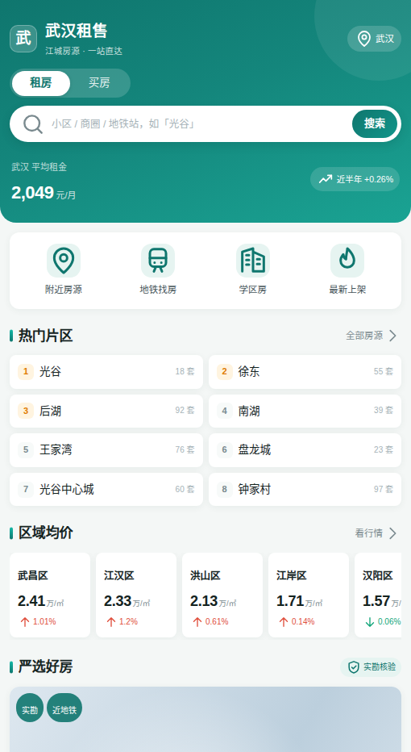
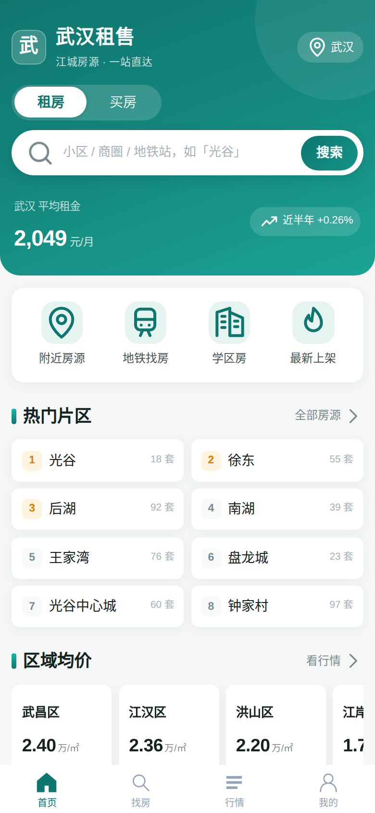
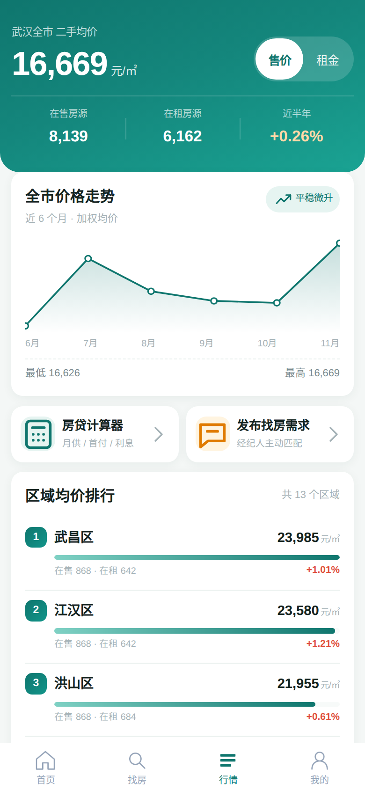
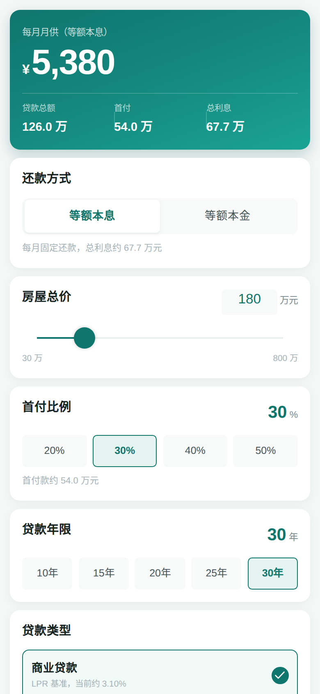

# 武汉租售 · 小程序

> 聚焦武汉本地的租房 / 买房一站式信息平台：真实小区数据、区域行情、房贷计算、房源发布，一个全栈可运行的小程序项目。

<p align="center">
  
</p>

## 功能一览

| 模块 | 能力 |
| --- | --- |
| 🏠 首页 | 租/售切换、热搜入口、热门片区榜、区域均价横滑卡、严选推荐、最新上架、学区专题 |
| 🔍 找房 | 区域两级联动（13 区 + 片区）、价格/户型/面积/朝向/地铁/特色筛选、4 种排序、无限加载 |
| 📄 房源详情 | 图集轮播、费用明细、**同小区租售对比 + 年租金回报率**、信息/配套/位置三 Tab、相似推荐 |
| 📈 行情 | 全市均价、近 6 个月走势图、13 区均价/租金排行（红涨绿跌）、租金回报解读 |
| 🧮 房贷计算器 | 商贷 / 公积金 / 组合贷，等额本息 vs 等额本金实时对比 |
| ✏️ 发布房源 | 两步表单 + 预览，发布后可上架/下架管理 |
| 👤 我的 | 收藏、浏览历史、我的发布、求租/求购需求登记 |

## 页面预览

| 首页 | 找房 | 行情 |
| --- | --- | --- |
|  |  |  |

| 详情 | 我的 | 计算器 |
| --- | --- | --- |
|  |  |  |

## 技术栈

**前端** `frontend/`
- [Taro 4.x](https://docs.taro.zone/) + React 18 + TypeScript —— 跨端小程序框架（微信 / 支付宝 / H5 等）
- SCSS 设计系统（`src/styles/theme.scss`）：信任青绿主色 `#0F766E`、750px 设计稿
- 自研轻量组件：`PropertyCover` 渐变建筑占位图（规避 WXSS 本地图片限制）、`Icon` 内联 SVG 图标库（30+ 线条图标）、`PropertyCard` 双形态卡片
- 无重量级图表库：走势图用内联 SVG、柱状图用纯 CSS 实现，控制包体积

**后端** `backend/`
- Express + TypeScript（ESM）+ Zod 参数校验 + Pino 日志
- 内存数据层：35 个武汉真实小区 × 多户型 ≈ 170 套种子房源、13 区行情趋势（确定性生成）
- JSON 协议：数据操作一律 `POST` + JSON body，GET 仅用于简单读取

## 快速启动

### 方式一：微信开发者工具（无需安装 Node，直接看小程序）

仓库已内置编译好的小程序产物 `weapp/`，克隆后即可运行：

```bash
git clone https://github.com/yeshi99/miniprogram.git
```

1. 打开**微信开发者工具** → 导入项目 → 目录选择 **仓库根目录**（不是 `frontend/`）
   - 工程配置 `project.config.json` 已指向 `weapp/`，无需手动设置
   - AppID 可选择「测试号」或填写自己的；`project.config.json` 默认游客 AppID
2. 详情 → 本地设置 → 勾选 **不校验合法域名、web-view（业务域名）、TLS 版本以及 HTTPS 证书**
3. 若页面数据为空，说明后端未启动，见下方「启动后端」

> 也可以直接导入 `weapp/` 子目录，效果相同。

### 启动后端（小程序与 H5 都需要）

数据来自本地 Express 服务（`http://localhost:3000`），需 Node.js ≥ 18：

- **Windows**：双击仓库根目录的 `start-backend.bat`（自动装依赖并启动）
- **macOS / Linux**：`bash start-backend.sh`
- 或手动：`pnpm --prefix backend install && cp backend/.env.example backend/.env && pnpm --prefix backend dev`

### 方式二：浏览器 H5 预览（改代码时热更新更方便）

```bash
pnpm --prefix backend install && pnpm --prefix backend dev   # 终端 1：后端 3000
pnpm --prefix frontend install && pnpm --prefix frontend dev:h5  # 终端 2：H5 5173
# 打开 http://localhost:5173
```

### 修改前端代码后重新生成小程序产物

```bash
pnpm --prefix frontend dev:weapp     # 监听模式，产物实时输出到 weapp/
# 或一次性构建
pnpm --prefix frontend build:weapp
```

`weapp/` 是构建产物但已纳入版本库，方便没有 Node 环境时直接导入开发者工具。

## API 摘要

完整协议见 `docs/product/features.md`。

| 方法 | 路径 | 说明 |
| --- | --- | --- |
| GET | `/api/health` | 健康检查 |
| POST | `/api/properties/list` | 房源列表（分页 + 筛选 + 排序） |
| POST | `/api/properties/search` | 关键词搜索 + 联想 |
| GET | `/api/properties/:id` | 房源详情（含租售对比） |
| POST | `/api/properties` | 发布房源 |
| POST | `/api/properties/similar` | 相似房源 |
| POST | `/api/favorites/toggle` · `/list` · `/status` | 收藏管理 |
| POST | `/api/market/overview` · `/districts` · `/district` | 区域行情 |
| POST | `/api/market/mortgage` | 房贷计算 |
| POST | `/api/user/*` | 我的发布 / 浏览历史 / 需求登记 |

用户身份通过请求头 `x-user-id` 标识（默认 `guest`）。

## 项目结构

```
├── backend/
│   └── src/
│       ├── app.ts              # Express 入口与路由挂载
│       ├── modules/            # properties / favorites / market / user
│       ├── services/           # 房源筛选排序、行情统计
│       ├── data/               # 小区/区域种子数据、内存存储
│       ├── types/              # Zod schemas
│       └── middleware/         # 校验 / 错误处理 / 日志
├── frontend/
│   ├── config/                 # Taro 构建配置（H5 代理等）
│   └── src/
│       ├── pages/              # 12 个页面（index/list/detail/market/...）
│       ├── components/         # PropertyCard / PropertyCover / Icon
│       ├── services/           # api-client 与接口封装
│       ├── styles/theme.scss   # 设计令牌
│       └── types/              # 前端类型
└── docs/                       # 产品文档、截图、海报
```

## 说明与限制

- 数据存于**内存**，服务重启后用户发布/收藏会重置；生产环境建议替换为数据库（接口层已隔离在 service）
- 电话联系为复制号码/弹窗演示，未接真实拨号与 IM
- 房源价格、行情数据为演示用种子数据，非真实成交数据

## License

MIT
